# Hi there, I'm Ricardo! 👋

Welcome to my GitHub profile. This space is dynamically updated with AI-powered content!

<!-- GENERATED_CONTENT_START -->

  
<table width="100%">
  <tr><td>
    <b>INSIGHT OF THE DAY</b> · COMPUTATIONAL DESIGN  
    <b>xFigura Unveils Multimodal Generative Design Platform for Streamlined Architectural Workflows</b> 
    xFigura, a new generative design platform, has launched, consolidating 90 distinct AI models into a unified &quot;canvas&quot; environment for architectural concept and project development. This platform aims to simplify the design process by allowing users to access text, drawings, and 3D models within a single interface, offering an intuitive experience for architects.  
    Source: <a href="https://vertexaisearch.cloud.google.com/grounding-api-redirect/AUZIYQHqYpnlc3c0xsqXKRvkvffPuD6pKDW-0Urxod2jYnqhDbWjxfQljHWFS7QqjcFQ_dhdLY_xmL0vL3Mci5CpIFIE4RMdEbSz5NTnQZKVlyGJQsn37GU0qW0Ml-rJT0WRubNGkiMm1isYFyHrULt-7UfHvqYrYeAQbTK2SA1Nq_-HCwj5HU9qhX4B_qzFQw==">Metropolis</a> · 2026-11-10 · via Google Gemini 2.5 Flash · updated 2026-11-12
  </td></tr>
</table>
 

  
<h3 align="center">🛠️ Tech Stack</h3>
<table align="center">
  <tr>
    <td align="center" width="25%">
      
       <b>TensorFlow • PyTorch</b> <b>Scikit-learn • OpenCV</b> <b>SciPy</b>
    </td>
    <td align="center" width="25%">
      
       <b>LangChain • Google ADK</b> <b>Amazon Bedrock • n8n</b> <b>Strands-Agents • Agno</b>
    </td>
    <td align="center" width="25%">
      
       <b>AWS • Lambda</b> <b>GCP • GitHub Actions</b> <b>Docker • CI/CD</b>
    </td>
    <td align="center" width="25%">
      
       <b>PowerBi • Plotly</b> <b>Matplotlib • Seaborn</b> <b>Numpy • Pandas</b>
    </td>
  </tr>
</table>
 
<h3 align="center">🤝 Let's Connect</h3>

  
  
  
  
  

  

Banner generated from a daily seed · updated with GitHub Actions &amp; Google AI Studio

<!-- GENERATED_CONTENT_END -->

